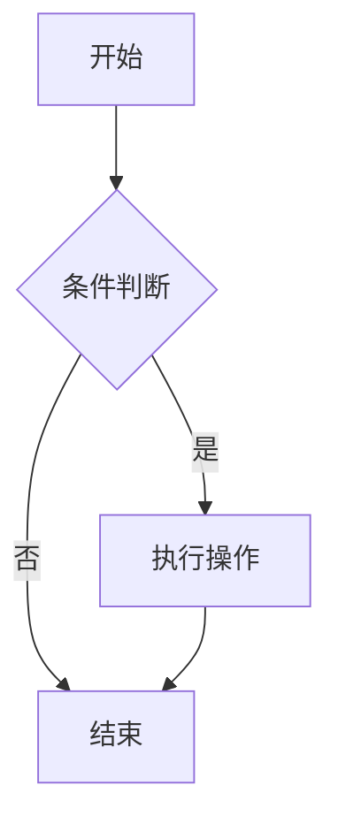
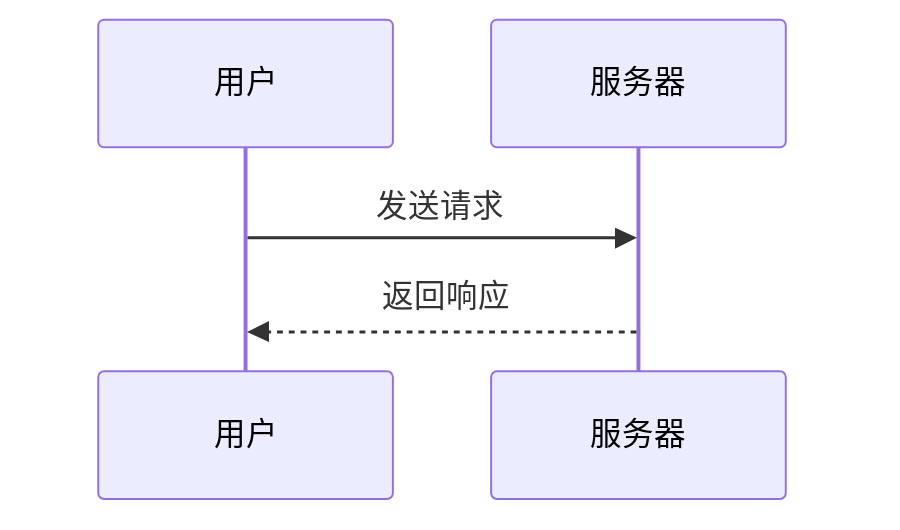

# Markdown 全语法测试文件

> 本文件尽可能覆盖 CommonMark、GitHub Flavored Markdown (GFM) 及常见扩展语法，用于渲染测试。

**目录**

- [1. 标题](#1-标题)
- [2. 段落与换行](#2-段落与换行)
- [3. 强调](#3-强调)
- [4. 行内代码](#4-行内代码)
- [5. 列表](#5-列表)
- [6. 链接](#6-链接)
- [7. 图片](#7-图片)
- [8. 引用块](#8-引用块)
- [9. 代码块](#9-代码块)
- [10. 表格](#10-表格)
- [11. 分隔线](#11-分隔线)
- [12. 转义字符](#12-转义字符)
- [13. 脚注](#13-脚注)
- [14. 表情符号](#14-表情符号)
- [15. 行内 HTML](#15-行内-html)
- [16. 数学公式](#16-数学公式)
- [17. Mermaid 图表](#17-mermaid-图表)
- [18. 定义列表与缩写](#18-定义列表与缩写)
- [19. 特殊字符与混合用例](#19-特殊字符与混合用例)

---

## 1. 标题

### 1.1 ATX 风格（# 号）

# 一级标题 H1

## 二级标题 H2

### 三级标题 H3

#### 四级标题 H4

##### 五级标题 H5

###### 六级标题 H6

### 1.2 Setext 风格（下划线）

# Setext 一级标题

## Setext 二级标题

### 1.3 闭合式 ATX

## 闭合式标题

### 1.4 标题中带格式

## 标题里可以有 **粗体**、*斜体*、`代码`

---

## 2. 段落与换行

这是一个普通段落。段落之间由一个或多个空行分隔。

这是同一段落内的软换行（源码中单独回车，通常渲染为空格）：
上一行与这一行在同一段落。

这是行尾两个空格实现的硬换行：  
新的一行。

这是行尾反斜杠实现的硬换行：\\
新的一行。

---

## 3. 强调

- *单星号斜体*
- *单下划线斜体*
- **双星号粗体**
- **双下划线粗体**
- ***三星号粗斜体***
- ***下划线套粗体***
- ~~双波浪删除线~~
- ==双等号高亮（GFM 扩展）==
- **~~删除线里套粗体~~**
- 混合：**粗体中的 *斜体* 和 `代码`**
- 强调不能跨越空格：*这是 不生效 的写法（含首尾空格）*

---

## 4. 行内代码

- 普通行内代码：`const x = 1;`
- 包含反引号的代码：``代码中有 ` 一个反引号``
- 代码中有多个反引号：```包含 `` 两个反引号```
- 行内代码中的符号不解析：`**不是粗体** 和 [不是链接](x)`
- 行内代码中的 HTML 不解析：`<div>不是标签</div>`

---

## 5. 列表

### 5.1 无序列表（三种符号）

- 减号项
- 星号项
- 加号项

### 5.2 有序列表

1. 第一项
2. 第二项
3. 第三项

### 5.3 有序列表（起始编号）

1. 从 8 开始
2. 递增为 9
3. 递增为 10

### 5.4 嵌套列表

- 一级
  - 二级
    - 三级
      - 四级
- 回到一级

1. 有序一级
   1. 有序二级
   2. 有序二级之二
2. 有序一级之二

### 5.5 有序与无序混合嵌套

1. 第一项
   - 无序子项 A
   - 无序子项 B
     1. 有序孙项
2. 第二项

### 5.6 列表项含段落与代码块

- 列表项一
- 列表项二带续行段落：

  这是该列表项内的第二段（缩进对齐）。
  ```
  列表项内的代码块
  ```

- 列表项三

### 5.7 任务列表（GFM）

- [x] 已完成任务
- [x] 已完成并带 `格式` 和 **粗体**
- [ ] 未完成任务
- [ ] 嵌套任务
  - [x] 子任务一
  - [ ] 子任务二

### 5.8 宽松与紧凑列表

- 紧凑列表项一
- 紧凑列表项二

- 宽松列表项一

- 宽松列表项二

---

## 6. 链接

### 6.1 行内链接

[行内链接](https://example.com)

### 6.2 带标题的行内链接

[带 title 的链接](https://example.com "悬停提示文字")

### 6.3 引用式链接

这是 [引用式链接][ref1]，还有 [简写引用][ref2]，以及 [隐式引用][ref3]。

[ref1]: https://example.com/ref "引用式链接标题"

[ref2]: https://example.com/short

[ref3]: https://example.com/implicit

### 6.4 自动链接

- 尖括号自动链接：<https://example.com/auto>
- 邮箱自动链接：<someone@example.com>
- 裸 URL（部分渲染器自动识别）：https://example.com/bare

### 6.5 格式化链接文字

[**粗体** 与 *斜体* 的链接](https://example.com/formatted)
[`代码` 链接](https://example.com/code)

### 6.6 相对路径链接

[相对路径链接](./markdown-test.md)

---

## 7. 图片

### 7.1 行内图片


### 7.2 引用式图片

![示例图片（引用式）][img-ref]

[img-ref]: https://via.placeholder.com/150/771796?text=Ref "引用式图片标题"

### 7.3 带格式的 alt 中不含图片

图片也可以出现在链接里：[](https://example.com)

---

## 8. 引用块

### 8.1 普通引用

> 这是一段引用。
> 可以多行书写，渲染为同一个块。

### 8.2 懒惰续行

> 第一行引用

第二行（源码中无 > 前缀，懒惰续行仍属于引用）。

### 8.3 嵌套引用

> 一级引用
> > 二级引用
> > > 三级引用
> 回到一级

### 8.4 引用中包含其他元素

> ### 引用中的标题
> 
> - 引用中的列表项
> - 第二项
> 
> ```js
> // 引用中的代码块
> console.log("quote");
> ```
> 
> **粗体** 和 [链接](https://example.com) 也可以出现。

### 8.5 GitHub 提示框（Alerts，GFM 扩展）

> [!NOTE]
> 这是 NOTE：强调用户应该注意的信息。

> [!TIP]
> 这是 TIP：可选的技巧或建议。

> [!IMPORTANT]
> 这是 IMPORTANT：关键信息。

> [!WARNING]
> 这是 WARNING：可能导致问题的操作。

> [!CAUTION]
> 这是 CAUTION：有风险的负面后果。

---

## 9. 代码块

### 9.1 缩进式代码块（每行前 4 空格）

```
function indented() {
  return "这是缩进式代码块";
}

```

### 9.2 无语言围栏代码块

```
这是无语言标注的围栏代码块。
保留   空格	与制表符。
```

### 9.3 JavaScript

```js
// JavaScript 语法高亮测试
const greet = (name) => {
  const msg = `Hello, ${name}!`;
  console.log(msg);
  return msg;
};
greet("Markdown");
```

### 9.4 Python

```python
# Python 语法高亮测试
from dataclasses import dataclass

@dataclass
class Point:
    x: float
    y: float = 0.0

def main() -> None:
    p = Point(1.5, 2.5)
    print(f"Point({p.x}, {p.y})")

if __name__ == "__main__":
    main()
```

### 9.5 JSON

```json
{
  "name": "markdown-test",
  "version": "1.0.0",
  "keywords": ["markdown", "gfm", "test"],
  "nested": { "enabled": true, "count": 42 }
}
```

### 9.6 Bash

```bash
#!/usr/bin/env bash
# Bash 语法高亮测试
set -euo pipefail
for f in *.md; do
  echo "处理 $f"
done
```

### 9.7 HTML

```html
<!DOCTYPE html>
<html lang="zh-CN">
  <body>
    <h1 class="title">HTML 代码块</h1>
  </body>
</html>
```

### 9.8 CSS

```css
/* CSS 语法高亮测试 */
.container {
  max-width: 960px;
  color: #333;
}
```

### 9.9 Diff

```diff
+ 新增的一行
- 删除的一行
! 变更标记（部分渲染器支持）
  上下文行
```

### 9.10 代码块中包含围栏（外层四反引号）

````markdown
本代码块外层使用四个反引号，内部可以安全展示三反引号围栏：

```python
print("内嵌的代码块")
```
````

### 9.11 围栏代码块信息串扩展（部分渲染器支持）

```js showLineNumbers {3} title="demo.js"
// 某些渲染器支持行号、行高亮等元信息
const a = 1;
const b = 2; // 这一行可能被高亮
console.log(a + b);
```

---

## 10. 表格

### 10.1 基本表格（三种对齐方式）

| 左对齐 | 居中对齐 | 右对齐 | 默认对齐 |
| :--- | :---: | ---: | --- |
| a | b | c | d |
| 10000 | 20000 | 30000 | 40000 |
| 文本 | 文本 | 文本 | 文本 |

### 10.2 表格内含行内元素

| 功能 | 语法 | 效果 |
| --- | --- | --- |
| 粗体 | `**x**` | **x** |
| 斜体 | `*x*` | *x* |
| 链接 | `[x](u)` | [示例](https://example.com) |
| 代码 | `` `x` `` | `x` |
| 删除线 | `~~x~~` | ~~x~~ |

### 10.3 单元格内竖线（需转义）

| 命令 | 说明 |
| --- | --- |
| `a \| b` | 单元格中的管道符用 `\|` 转义 |

### 10.4 无表头分隔线边距的紧凑写法

|A|B|

|-|-|

|1|2|

---

## 11. 分隔线

以下三种写法均生成水平分隔线：

---

---

---

---

## 12. 转义字符

- 星号：\*
- 下划线：\_
- 井号：\\#
- 加号：\\+
- 减号：\\-
- 点号：\\.
- 叹号：\\!
- 反引号：\`
- 圆括号：\\( \\)
- 方括号：[ ]
- 花括号：\\{ \\}
- 管道符：\\|
- 反斜杠：\\
- 尖括号：\\< \\>
- 大于号 \\> 与与符号 \\& 直接可写：> &

---

## 13. 脚注

这是一句话，其中包含一个短脚注[^1]，和一个长脚注[^long]，还有行内注记\^[这是行内脚注，Pandoc 扩展]。

[^1]: 这是短脚注的内容。

[^long]: 这是长脚注的内容，可包含多个段落。

    第二段落也属于该脚注。

    - 脚注里还能有列表。

---

## 14. 表情符号

### 14.1 GitHub 短代码（shortcode）

:smile: :heart: :tada: :rocket: :+1: :100%: :warning:

### 14.2 Unicode 直接输入

😀 😄 ❤️ 🎉 🚀 👍 ✅ ❌ ⚠️ 中文标点：，。！？

---

## 15. 行内 HTML

### 15.1 常见行内标签

- 粗体标签：**HTML 粗体**
- 斜体标签：*HTML 斜体*
- 下划线：<u>HTML 下划线</u>
- 高亮：<mark>HTML 高亮</mark>
- 上标：H~2~O 与 X^2^
- 键盘按键：`Ctrl` + `C` 复制
- 小号字体：<small>小字</small>
- 缩写标签：<abbr title="HyperText Markup Language">HTML</abbr>

### 15.2 块级 HTML：折叠面板

<details>
<summary>点击展开详情（details / summary）</summary>

折叠内容里**可以**包含 Markdown：

- 列表项
- `代码`

```js
console.log("折叠内容中的代码");
```

</details>

### 15.3 块级 HTML：居中与引用

<div align="center">

这里使用 HTML div 居中包裹的 Markdown 段落。

</div>

### 15.4 HTML 注释

<!-- 这是 HTML 注释，渲染后不可见。 -->

### 15.5 HTML 实体

&amp; &copy; &reg; &trade; &lt; &gt; &quot; &hellip; &mdash; &times; &divide;

---

## 16. 数学公式

### 16.1 行内公式

质能方程 $E = mc^2$，欧拉公式 $e^{i\pi} + 1 = 0$。

### 16.2 块级公式

$$
\int_{a}^{b} f(x)\,dx = F(b) - F(a)
$$

$$
\sum_{n=1}^{\infty} \frac{1}{n^2} = \frac{\pi^2}{6}
$$

### 16.3 公式中的矩阵

$$
A = \begin{pmatrix}
a_{11} & a_{12} \\
a_{21} & a_{22}
\end{pmatrix}
$$

---

## 17. Mermaid 图表

### 17.1 流程图



### 17.2 时序图



---

## 18. 定义列表与缩写

### 18.1 定义列表（Pandoc / PHP Markdown Extra 扩展）

Markdown
:   一种轻量级标记语言。

CommonMark
:   Markdown 的标准化规范。
:   具有明确的解析规则。

### 18.2 缩写（Abbreviations 扩展）

HTML 与 CSS 是网页的基石。

*[HTML]: HyperText Markup Language
\*[CSS]: Cascading Style Sheets*\*[HTML]: HyperText Markup Language
\*[CSS]: Cascading Style Sheets

---

## 19. 特殊字符与混合用例

### 19.1 中英混排与全半角

English 与中文混排，加上标点：，、。！？"引号"（全角）与 "quotes"（半角）。

### 19.2 连续特殊符号

…… －－－ —— \*\*\* \_\_\_ ### ||| <<< >>> \~\~\~ \^\^\^

### 19.3 数字与单位

3.14159、1,000,000、50%、±1、×2、÷3、℃、§1、№5

### 19.4 综合嵌套用例

> ## 引用中的综合示例
> 
> 1. 引用中的有序列表
>    - 嵌套无序项，包含 **粗体**、*斜体*、`代码`、~~删除线~~、==高亮==
>    - 以及 [链接](https://example.com) 与 
> 2. 第二项包含任务列表：
>    - [x] 完成
>    - [ ] 待办
> 
> $$
> e = mc^2
> $$

---

## 结束

*本文件到此结束。若以上所有元素均正确渲染，说明该渲染器对 Markdown / GFM 支持完整。*